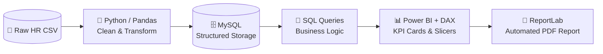

<div align="center">

# 🧑‍💼 Employee Salary & Headcount Dashboard

**An end-to-end HR analytics pipeline — from dirty CSV to a decision-ready Power BI dashboard.**

`Python` · `Pandas` · `MySQL` · `SQL` · `Power BI` · `DAX` · `ReportLab`

</div>

---

## 📸 Dashboard Preview

<!-- FILL THIS IN — this is the highest-impact thing in the whole README.
     Export your Power BI dashboard as a PNG (File → Export → Image),
     drop it in an /assets folder in this repo, then reference it below. -->


> 💡 *Replace `assets/dashboard.png` with a real screenshot of your dashboard. Recruiters won't open a `.pbix` file — they will look at a picture.*

---

## 🎯 The Business Problem

HR teams need to answer questions like:

- Are we paying fairly **across departments and locations**?
- Where is our **headcount growing** — and where is it quietly shrinking?
- Which departments carry the **highest salary load** relative to their size?
- Are there **outliers** (over/under-paid roles) worth investigating?

Raw HR exports don't answer these. They're messy, inconsistent, and unaggregated. This project builds the pipeline that turns that raw export into answers.

---

## 🗂️ Dataset

| | |
| --- | --- |
| **Source** | <!-- FILL: e.g. "Synthetic/Kaggle HR dataset" --> |
| **Rows** | <!-- FILL: e.g. "1,000+ employee records" --> |
| **Key fields** | Employee name, department, job title, city, salary, hire date, headcount |
| **Coverage** | Multiple Kenyan cities, multiple departments |

---

## 🏗️ Architecture



**Why this order?** Each stage does one job well: Python for messy cleaning, SQL for reliable aggregation, Power BI for the visual layer, and ReportLab for a shareable report that doesn't require opening a BI tool.

---

## ❓ Questions This Analysis Answers

<!-- These are the questions the dashboard responds to. Confirm/adjust to match your actual slicers and KPIs. -->

1. What is total headcount and how has it changed over time?
2. Which departments have the highest average salary?
3. How does salary vary across cities?
4. What is the salary distribution within each department (spread, not just average)?
5. Where are the outliers — roles paid well above/below their peers?

---

## 🔍 Key Findings

<!-- ⚠️ Replace every [X] with YOUR real numbers from the analysis.
     Do NOT publish a number you can't defend in an interview. -->

- **Headcount** grew from `[X]` to `[Y]` employees over the period — a `[Z%]` change.
- **`[Department A]`** carries the highest average salary at `$[X]`, roughly `[Y%]` above the company mean.
- Salaries vary by `[X%]` across cities for the same role band, suggesting **location-adjusted pay gaps** worth reviewing.
- `[N]` employees fell outside the expected salary range for their role — potential **mis-grading or retention risk**.

> **Recommendation:** `[One clear, actionable line — e.g. "Review pay bands in Department A and align location adjustments across the three highest-cost cities."]`

---

## 📊 Dashboard Features

- **KPI cards** — total headcount, average salary, departments covered
- **Hiring trend line** — headcount movement over time
- **Slicers** — filter by department and city
- **Department & city breakdowns** — compare salary and headcount side by side
- **Automated PDF export** — a shareable report generated with ReportLab

---

## 📁 Repository Structure

```
employee-salary-headcount-dashboard/
├── assets/
│   └── dashboard.png          # dashboard screenshot
├── data/
│   └── raw_employees.csv      # source data
├── notebooks/
│   └── cleaning.ipynb         # Python/Pandas cleaning
├── sql/
│   └── analysis_queries.sql   # business-logic queries
├── reports/
│   └── employee_report.pdf    # ReportLab output
├── dashboard.pbix             # Power BI file
└── README.md
```

> Adjust the file names above to match your actual repo.

---

## ▶️ How to Reproduce

```bash
# 1. Clone
git clone https://github.com/Riq-wq/employee-salary-headcount-dashboard.git
cd employee-salary-headcount-dashboard

# 2. Install Python dependencies
pip install pandas mysql-connector-python reportlab

# 3. Run the cleaning script
python notebooks/cleaning.py

# 4. Load into MySQL
mysql -u <user> -p < database setup.sql

# 5. Open dashboard.pbix in Power BI Desktop and refresh
```

---

## 🧠 Skills Demonstrated

| Skill | Where |
| --- | --- |
| **Data cleaning** (missing values, types, duplicates) | `notebooks/cleaning.ipynb` |
| **Relational storage & schema design** | MySQL |
| **Business-logic SQL** (aggregation, grouping, ranking) | `sql/analysis_queries.sql` |
| **Data modeling & DAX measures** | Power BI |
| **Automated reporting** | ReportLab |
| **End-to-end pipeline thinking** | Whole repo |

---

## 🚀 What I'd Do Next

- Add **salary-benchmark comparison** against an external market dataset
- Introduce **attrition analysis** if historical exit data becomes available
- Migrate the pipeline to **dbt + a cloud warehouse** for scheduled refreshes

---

<div align="center">
<sub>Built by <a href="https://github.com/Riq-wq">Hassan Jumaa</a> · <a href="https://riq-wq.github.io/Myportfolio/">Portfolio</a> · <a href="https://www.linkedin.com/in/mrisa-juma-56a600416">LinkedIn</a></sub>
</div>
