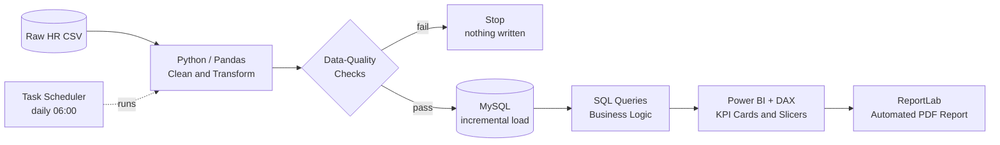
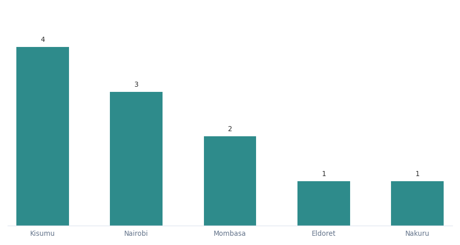
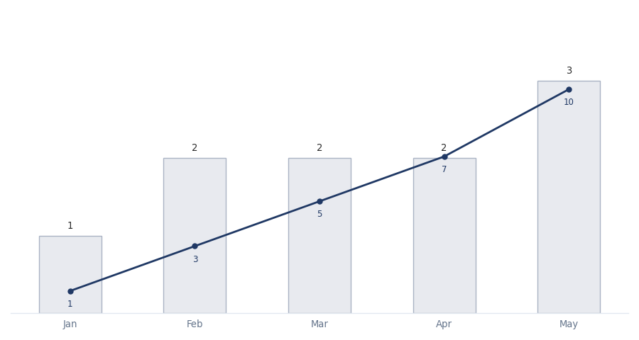
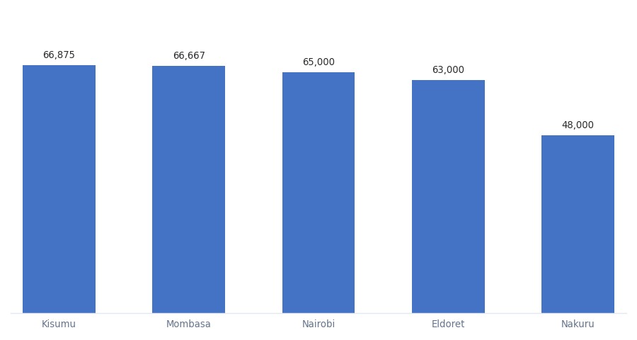

<div align="center">

# Employee Salary & Headcount Dashboard

**An end-to-end HR analytics pipeline — from a raw, messy CSV to a decision-ready Power BI dashboard.**

`Python` · `Pandas` · `MySQL` · `SQL` · `Power BI` · `DAX` · `ReportLab`

</div>

---

## Dashboard Preview


---

## 🎯 The Business Problem

A growing company is hiring fast across several cities, but HR has no clean view of:

- **Are we paying fairly across cities — or is location creating hidden pay gaps?**
- **How fast is headcount growing, and where?**
- **Which hires sit far outside expected pay ranges?**

The raw export is small, inconsistent, and unaggregated, so it answers none of these directly. This project builds the pipeline that turns it into answers.

---

## 🗂️ Dataset

| | |
| --- | --- |
| **Source** | Raw HR export (CSV) — deliberately messy, as in the real world |
| **Raw rows** | 10 |
| **Clean rows** | 9 |
| **Fields** | `EmployeeID`, `Name`, `Age`, `City`, `Salary`, `JoinDate` |
| **Coverage** | 5 Kenyan cities · Jan–May 2025 · ages 25–40 |

### 🧹 Data-Quality Issues & Cleaning Decisions

The raw export contained **7 distinct problems** — enough to make any naive analysis wrong. Each was fixed deliberately and documented, never silently:

| Row | Raw problem | Decision | Reasoning |
| --- | --- | --- | --- |
| `ID 2` (Bob) | `Age` blank | Imputed **29** (median age) | Median is robust to outliers; safe for a single gap |
| `ID 3` (Charlie) | `Salary` blank | Imputed **59,500** (median salary) | The 900,000 typo makes the mean unusable — median is safer |
| `ID 4` (Alice) | **Exact duplicate** of `ID 1` | **Row removed** | Same person twice would double-count headcount and salary bill |
| `ID 5` (Diana) | `City` blank | Filled with **Kisumu** | ⚠️ **Assumption, not a recovery** — see [Limitations](#-limitations--honest-scope) |
| `ID 7` (Faith) | `Age = -5` | Corrected to **29** | A negative age is invalid data, not a real value |
| `ID 8` (George) | `Salary = 900,000` | Corrected to **90,000** | A 10× typo — inconsistent with the role and every peer |
| `ID 9` (—) | `Name` blank | Placeholder **"Jamal"** | ⚠️ Name assumed — see [Limitations](#-limitations--honest-scope) |

> 📎 **Row IDs refer to the raw export.** The cleaned file drops the duplicate and renumbers, so raw `ID 5` (Diana) is `ID 4` in `employee_dataset_cleaned.csv` — cross-reference by name, not by number.

> ⚠️ **Why this matters.** Computed on the raw data, the average salary comes out at **KES 151,111**. The true figure is **KES 61,611** — the uncleaned number is **145% too high**. A single `900,000` typo and one duplicate row are enough to make a dashboard actively mislead. This step is the analysis.

---

## ⚠️ Limitations & Honest Scope

A dashboard that hides its own gaps is worse than no dashboard. Two values in this dataset are **assumptions I made, not facts I recovered** — stated plainly so the numbers can be trusted correctly:

| Value | Status | Why it is not recoverable | Impact |
| --- | --- | --- | --- |
| **Diana's `City` → Kisumu** | **Assumption** | Location cannot be derived from age, salary, or join date. The mode is not unique — Kisumu, Mombasa and Nairobi each appear twice, so "most common city" has no single answer. | Affects **one cell**: Kisumu's average is **63,500** *with* the assumption, **60,250** without it. |
| **ID 9's `Name` → "Jamal"** | **Placeholder** | Names carry no analytical weight — no calculation touches this field. | **None.** No metric depends on it. |

**What survives either way.** Total salary **554,500** · mean **61,611** · median **59,500** · the **145%** cleaning finding · the **outlier detection** — all identical regardless of either assumption. Only Kisumu's city average moves.

**If I were redoing this for a real stakeholder:** I would leave both fields as `Unknown`, exclude Diana from the city comparison, and report **8 of 9** employees against location. On a nine-row dataset that costs almost nothing, and it removes the only judgment call in the pipeline.

---

## 🏗️ Architecture



**Why this order?** Each stage does one job well: Python for messy cleaning, SQL for reliable aggregation, Power BI for the visual layer, and ReportLab for a shareable report that doesn't require opening a BI tool.

The **validation gate is deliberate**: if the data doesn't meet the documented expectations, the run stops *before* anything is written. A pipeline that fails loudly is more trustworthy than one that quietly emits a plausible-looking dashboard.

---

## ⚙️ Automation

The notebook is the learning artefact — it shows the reasoning step by step. `scripts/pipeline.py` is the same logic packaged to run unattended. Both exist on purpose.

```bash
python scripts/pipeline.py          # clean -> validate -> load (one command)
python scripts/checks.py            # validate the data on disk, no writes
python scripts/run_scheduled.py     # what the scheduler calls: pipeline + log + history
python scripts/run_scheduled.py --no-commit   # run without recording the history
```

**Stages**

| # | Stage | What happens |
| --- | --- | --- |
| 1 | Read | raw HR export → DataFrame |
| 2 | Clean | dedupe, impute, correct outliers, renumber IDs |
| 3 | **Validate** | 15 checks; **fails the run on any mismatch** |
| 4 | Write + Load | cleaned CSV, then incremental load into MySQL |

**The checks (`scripts/checks.py`)** work in two directions:

| Layer | Proves |
| --- | --- |
| **Input** (raw) | the file contains *exactly* the 7 documented defects — no more, no fewer |
| **Output** (clean) | no nulls, plausible age/salary ranges, IDs renumbered, assumptions unchanged, and the headline figures within a sane distance of the last run |

The clearest justification for this layer: the raw file originally contained `Age = -5`. That one invalid value contaminated the median, which then contaminated every imputed age. `check_age_range` now catches exactly that class of error automatically.

**The gate is growth-aware.** The first version of these checks hard-coded `9 rows` and `554,500` and rejected *any* new employee — which is a wall, not a gate, and walls get switched off. The checks are now split by kind:

| Kind | Examples | Behaviour |
| --- | --- | --- |
| **Structural** — true for any correct dataset | no nulls · ages 18–70 · salaries in range · every defect repaired · IDs 1..N | scale freely; no expectation to update |
| **Count** — true for one particular dataset | row counts, headline totals, duplicates dropped | compared to the **previous successful run** rather than fixed |

Adding an employee is therefore accepted and **reported**. Removing rows is treated more carefully, because the two cases mean different things: a **departure is a decision** and passes (it is reported as `GONE:`), while a **truncated export is a defect** and is blocked. The rule is that a run may not lose more than `MAX_ROW_LOSS_PCT` (40%) of its rows in one go, and the salary bill may not move by more than `MAX_TOTAL_MOVE_PCT` (80%) — the latter is what catches a duplicated or corrupted export.

**What change reporting looks like (`data/.pipeline_state.json`)** — each successful run records a small snapshot, and the next run diffs against it. *The example below shows what the output looks like when someone new is added — it illustrates the format, and does not change any of the figures in this README, which describe the published nine-employee snapshot:*

```
Comparing to last successful run (2026-10-21T16:39:55+00:00)
  rows     9 -> 10   (+1)
  total    554,500 -> 631,000   (+76,500)
  mean     61,611 -> 63,100   (+1,489)
  median   59,500 -> 61,000   (+1,500)
  salary bill moved +13.8%
  NEW: Kirau
```

**Generated files are protected from hand-edits.** `employee_dataset_cleaned.csv` is *output* — it is rebuilt from the raw source on every run, so an edit to it would be silently overwritten. The state file therefore records the SHA-256 of the cleaned CSV as written, and the pipeline compares that against the file on disk before rebuilding it. If they differ, it says so and points you at the file to edit instead:

```
WARNING: the cleaned CSV was edited by hand since the last run.
  file   : data\employee_dataset_cleaned.csv
  last written : 162FA78CD6F37235...
  now on disk  : 3E80EE98C74BE615...
  This file is REGENERATED from the raw source on every run,
  so those edits are about to be overwritten.
  To add an employee, edit the RAW source instead:
    data\employee dataset.csv
```

**Which file to edit:** `data/employee dataset.csv` is the **source** — edit it, and the row flows through to the cleaned CSV, MySQL, the PDF report and the dashboard. `data/employee_dataset_cleaned.csv` is **output** — it is regenerated on every run and anything written there by hand is discarded.

### ✏️ Editing the source file safely

The source is a CSV, so the natural move is to open it in Excel. That works — but **Excel reads dates in its own regional order, and this machine is set to month-first.** The file is **day-first** (`dd/mm/yyyy`), so a date you type can be silently reinterpreted:

| you type | Excel reads it as | the file ends up with |
| --- | --- | --- |
| `01/06/2025` | 6 January 2025 | `06/01/2025` — five months out |
| `15/06/2025` | 15 June 2025 | `15/06/2025` — fine (the day is above 12) |

Excel opens the existing dates correctly, so a plain open-and-save looks perfectly normal afterwards. And the gate **cannot** catch this one: `06/01/2025` is a perfectly valid day-first date, so no check on the data can tell it apart from a date that was always meant to be 6 January. The fix has to happen *before* the date is typed.

**So edit the file with the safe editor:**

```bash
python scripts/edit_source.py
```

It opens the file in Excel with three things already handled:

- the `JoinDate` column is **Text**, so a date is saved exactly as you type it;
- the numeric columns are pinned to a plain integer format, so a large salary can never come out as `1.2E+06`;
- Excel's autocorrect and autocomplete are switched off for the session, so it cannot change your capitalisation or complete a city name behind your back.

It backs the file up first, and after you save and close it verifies the result and prints exactly what changed. If the file comes back broken, the backup is restored and nothing is lost.

```
Source: data\employee dataset.csv  (10 rows)
Backup : data\.edit_backup\employee dataset 2026-10-21 18:42:11.csv

  Excel is open and ready to edit.
  The JoinDate column is TEXT, so a date is saved exactly as you
  type it (dd/mm/yyyy - day first, like the rest of the file).

  Edit, press Ctrl+S, then close Excel. This script will verify
  the file and tell you what changed.

Verifying the file...

OK - the file is a valid source file.

What changed:
  added   : 11 Zawadi
```

**If you edit it some other way**, the gate catches the damage it *can* see — a date written as an Excel serial, in ISO format, with dashes, unpadded, with a two-digit year, or as an impossible date:

```
[FAIL] raw: date format is dd/mm/yyyy    2 JoinDate value(s) are not dd/mm/yyyy: row 2: '45672'
PIPELINE STOPPED - data-quality checks failed
```

### 📜 Where the history lives

Three different questions get three different answers, in three different places.

| Question | Answer | Committed? |
| --- | --- | --- |
| *What did each run do?* | `logs/pipeline_<timestamp>.log` | ❌ local only (git-ignored) |
| *How did the numbers change over time?* | **`git log` on the state file** | ✅ yes — this is the record |
| *When was this specific row last written?* | `last_updated` column in MySQL | in the database |

**The git log is the history.** A state file on its own is only a *latest snapshot* — each run overwrites the last, so the history would be gone. So a successful run commits that file to git, and the commit log becomes the audit trail: *example output:*

```
$ git log --oneline -- data/.pipeline_state.json
Run 2026-10-22 06:00 - 10 rows, total 631,000
Run 2026-10-21 06:00 - 9 rows, total 554,500
```

Each message carries the headline numbers, and the people who joined or left. *Example — the message a run produces when a new hire has joined:*

```
Run 2026-10-22 06:00 - 10 rows, total 631,000

rows   : 10
total  : 631,000
mean   : 63,100
median : 61,000

joined : Kirau

Recorded automatically by scripts/run_scheduled.py
```

A run where nothing changed says so, so a routine run is distinguishable from a change in the log: *Example — the message from a run where the data was identical to the previous one:*

```
Run 2026-10-21 06:00 - 9 rows, total 554,500

rows   : 9
total  : 554,500
mean   : 61,611
median : 59,500

no data change since the last run

Recorded automatically by scripts/run_scheduled.py
```

Any point in time can be inspected directly:

```bash
git show <commit>:data/.pipeline_state.json
```

**Three rules keep that automatic commit safe.**

1. **Only the state file is staged.** Unrelated work in progress in the working tree is left completely alone.
2. **A failed run commits nothing.** The state file is only updated after the pipeline has already succeeded, so the recorded history always matches data that actually exists. A run that fails the data-quality gate leaves both the file and the log untouched.
3. **It never pushes unreviewed work.** The push only happens when the local branch is level with its remote. If there are local commits that have not been reviewed, the history is still recorded locally and the push is skipped with a note.

If git is unavailable, misconfigured or offline, the run still counts as a success — history is a nice-to-have; the pipeline's job is the data.

**The logs are the debugging layer, not the history.** Each run writes `logs/pipeline_<timestamp>.log` with the full check output, exit code and duration, and the folder keeps the 30 most recent files. They are git-ignored on purpose: they are machine output for diagnosing a failure, and the durable record belongs in git.

The numbers in this README describe the **nine-employee snapshot** the analysis was published on. They remain true of that snapshot; the state file is what keeps the current totals honest once the data grows.

**Incremental loading (`scripts/incremental.py`)** replaces the notebook's `if_exists="replace"`:

| Situation | Action |
| --- | --- |
| New `EmployeeID` | INSERT |
| Existing, values differ | UPDATE |
| Existing, identical | SKIP — no write at all |
| In DB but absent from source | **report, do not delete** |

Replacing the table every run drops indexes and constraints, briefly leaves the table **empty**, and rewrites every row even when nothing changed. The incremental loader touches only what actually differs, and re-running with unchanged data performs **zero writes**.

Rows that disappear from the source are deliberately **not deleted** — a truncated export must never be able to wipe the employee table. They are logged instead, so the discrepancy is visible rather than silent.

> **Note on scale:** the loader handles an appended history — it inserts new records and updates changed ones without touching the rest, so cost scales with the size of the change rather than the size of the table. On this nine-row export, which is *corrected* rather than *appended*, that behaviour is verifiable rather than dramatic: a re-run performs **zero writes**, which is how the correctness is confirmed rather than assumed. The same applies to the gate — see **Growth-aware gate** above for what happens when rows are added.

**Scheduling (`scripts/register_task.ps1`)** registers a daily Windows Task Scheduler job:

```powershell
powershell -ExecutionPolicy Bypass -File scripts\register_task.ps1          # daily 06:00
powershell -ExecutionPolicy Bypass -File scripts\register_task.ps1 -Time 07:30
powershell -ExecutionPolicy Bypass -File scripts\register_task.ps1 -Remove
```

Every scheduled run writes a timestamped log to `logs/` and returns a distinct exit code, so Task Scheduler's history records *why* a run failed: `0` success · `2` data-quality failure · `3` database unreachable · `4` unexpected error.

**What the scheduler can and cannot promise.** Being precise about this matters more than making the claim sound good:

| Behaviour | Setting | Why |
| --- | --- | --- |
| Runs if the machine was off at 06:00 | `StartWhenAvailable` | a missed run happens on wake instead of being skipped silently |
| Runs **on battery power** | `AllowStartIfOnBatteries` | Windows defaults this to *off* — without it, a laptop on battery never runs the job at all |
| Is not killed if the charger is pulled mid-run | `DontStopIfGoingOnBatteries` | the default would stop a run halfway through |
| Needs the user to be **signed in** | `LogonType Interactive` | deliberately avoids storing a password; the trade-off is that the job does not run while signed out |

The battery defaults were a genuine bug found by testing the task rather than assuming it worked: the job sat in `Queued` forever on an unplugged laptop. The whole run takes about three seconds and writes nine rows to a local database, so fencing it off from battery power served no purpose. In production this job would move to a server under a service account, where the machine is always on and the user is never involved.

**Power BI refresh is documented, not scripted.** Refreshing the `.pbix` is a GUI action in Power BI Desktop; Power BI Desktop cannot be driven headlessly from Task Scheduler. In production the equivalent is **scheduled refresh in the Power BI Service**, which runs on Microsoft's side against a published dataset and needs no local machine to be awake. Below is the accurate local picture:

```
Task Scheduler (06:00) -> run_scheduled.ps1 -> pipeline.py
                                                 ├── clean
                                                 ├── validate   (stops here on failure)
                                                 ├── write CSV
                                                 └── incremental load -> MySQL
                                                                          |
                                        Power BI dashboard refresh  <-----+  (manual, or
                                        Service scheduled refresh in production)
```

---

## ❓ Questions This Analysis Answers

1. What is the total headcount and salary bill?
2. How has headcount grown month over month?
3. How does average salary differ by city?
4. How does pay relate to age / experience?
5. Which employees sit outside the normal pay range?

---

## 🔍 Key Findings

- **Headcount grew from 1 to 9 employees in five months** (Jan–May 2025), with a steady ~2 hires per month from February onward.
- **The pay distribution is right-skewed.** Mean salary is **KES 61,611** but the median is **KES 59,500** — a small number of high earners pull the average above what a typical employee earns. Any "average salary" headline is misleading on its own.
- **Nairobi pays the most — but the number is deceptive.** Its average of **KES 72,500** is **17.7% above the company mean**, yet that is driven almost entirely by a *single* senior hire. Nairobi's average is not evidence of a systematic city premium.
- **Nakuru is the lowest-paying city** at **KES 48,000**, **22% below** the company mean, and **Eldoret** sits at **KES 51,000**.
- **Age is the strongest single predictor of salary.** Pearson **r = 0.845** (**r² = 0.71**) — age alone explains roughly **71%** of salary variance in this dataset. The youngest employee (25) earns **KES 55,000**; the oldest (40) earns **KES 90,000** — a **1.64×** gap.
- **One statistical outlier.** George's **KES 90,000** sits above the Tukey upper fence of **KES 85,500** (Q1 = 53,000, Q3 = 66,000, IQR = 13,000). He is the only employee flagged.
- **Cleaning changed the entire conclusion.** Computed on the raw export, average salary reads **KES 151,111**; correctly cleaned it is **KES 61,611** — a **145% inflation** caused by a single `900,000` typo and one duplicated row. Untreated, this data would have produced a false narrative.

> **Recommendation**
> 1. **Introduce age/experience-based pay bands** so compensation tracks seniority explicitly rather than implicitly — the r² of 0.71 says seniority is already driving pay, just informally.
> 2. **Review the single senior outlier** against market benchmarks before treating Nairobi's average as a real signal.
> 3. **Add validation at the source.** A primary-key constraint to block duplicate `EmployeeID`s, a range check to reject impossible ages, and a sanity cap on `Salary` would have caught all 7 issues before they reached a report — this is cheaper than cleaning downstream every time.

---

## 📊 Dashboard Features

- **KPI cards** — total headcount, total salary bill, average salary
- **Headcount trend line** — monthly hiring, Jan–May 2025
- **City slicer** — filter every visual by location
- **Month slicer** — filter every visual by month
- **Average salary by city** — ranked comparison
- **Age vs salary scatter** — visualises the experience–pay relationship and isolates the outlier
- **Automated PDF export** — a shareable report generated with ReportLab

### Individual visuals

| | | |
| :---: | :---: | :---: |
|  |  |  |
| **Headcount by city** | **Hiring trend** | **Salary by city** |

---

## 📁 Repository Structure

```
employee-salary-headcount-dashboard/
├── assets/
│   └── dashboard.png                              # Power BI dashboard screenshot
├── data/
│   ├── employee dataset.csv                       # raw HR export (10 rows, messy) - the source
│   ├── employee_dataset_cleaned.csv               # cleaned output (9 rows) - regenerated each run
│   └── .pipeline_state.json                       # last successful run, and the run history (committed)
├── dashboard/
│   └── Employee salary dashboard.pbix             # Power BI file
├── notebooks/
│   └── employee  data cleaning.ipynb              # Python/Pandas cleaning + MySQL load
├── reports/
│   ├── Employee Salary & Headcount Dashboard.pptx # slide deck
│   ├── Employee_Salary_Dashboard_Report.pdf       # ReportLab PDF output
│   ├── charts/
│   │   ├── headcount_by_city.png
│   │   ├── hiring_trend.png
│   │   └── salary_by_city.png
│   └── generate_report.py                         # regenerates the PDF from the data
├── scripts/                                       # automation (see Automation above)
│   ├── pipeline.py                                # clean -> validate -> load, one command
│   ├── checks.py                                  # 15 data-quality checks
│   ├── state.py                                   # run-over-run change detection
│   ├── incremental.py                             # insert/update/skip instead of replace
│   ├── edit_source.py                             # open the source CSV in Excel, safely
│   ├── run_scheduled.py                           # pipeline + log file + exit codes + history commit
│   ├── run_scheduled.ps1                          # Task Scheduler entry point
│   └── register_task.ps1                          # creates/removes the daily task
├── sql/
│   └── employees queries.sql                      # business-logic queries
├── .env.example                                   # credential template
├── .gitattributes                                 # keep PDFs/deck/images binary
├── .gitignore
├── requirements.txt
└── README.md
```

`logs/` is created at runtime by the scheduled runner and is git-ignored — it is the debugging layer, not the record. `data/.pipeline_state.json` **is** committed, and a successful run commits it automatically, so the history is the git log:

```bash
git log --oneline -- data/.pipeline_state.json
```

---

## ▶️ How to Reproduce

### Option A — one command (automated)

```bash
# 1. Clone
git clone https://github.com/Riq-wq/employee-salary-headcount-dashboard.git
cd employee-salary-headcount-dashboard

# 2. Install Python dependencies
pip install -r requirements.txt

# 3. Create the database
mysql -u <user> -p -e "CREATE DATABASE employee_db;"

# 4. Add credentials
copy .env.example .env      # then edit .env with your MySQL values

# 5. Run the whole pipeline: clean -> validate -> write CSV -> load MySQL
python scripts/pipeline.py

# 6. (optional) schedule it to run daily at 06:00
powershell -ExecutionPolicy Bypass -File scripts\register_task.ps1
```

Step 5 exits `0` on success and `2` if the data fails validation, writing nothing in the failure case. You can also validate the data already on disk without writing anything:

```bash
python scripts/checks.py
```

### Option B — step by step (the learning path)

```bash
# 4. Run the cleaning notebook (cleans data + loads it into MySQL)
jupyter notebook "notebooks/employee  data cleaning.ipynb"
#    -> run all cells; connects via .env, loads to employee_db

# 5. Run the analysis queries
mysql -u <user> -p employee_db < "sql/employees queries.sql"

# 6. Open "dashboard/Employee salary dashboard.pbix" in Power BI Desktop and refresh

# 7. Regenerate the PDF report from the data (optional)
python reports/generate_report.py
```

> **Note:** DB credentials are read from an untracked `.env` file. Create one next to the notebook (or at the project root) with your own values — never hard-code them:
> ```
> DB_USER=<user>
> DB_PASSWORD=<your-password>
> DB_HOST=localhost
> DB_PORT=3306
> DB_NAME=employee_db
> ```

> **Power BI refresh:** refreshing the dashboard is a manual step in Power BI Desktop. It is not scripted here because Desktop has no headless mode. In production this becomes **scheduled refresh in the Power BI Service** against a published dataset.

---

## 🧠 Skills Demonstrated

| Skill | Where |
| --- | --- |
| **Data cleaning** — missing values, duplicate detection, invalid ranges, outlier correction | `notebooks/employee  data cleaning.ipynb` |
| **Relational storage & schema design** | MySQL |
| **Business-logic SQL** — aggregation, grouping, ranking | `sql/employees queries.sql` |
| **Distribution analysis** — mean vs median, IQR outlier detection | Analysis + report |
| **Statistical testing** — Pearson correlation, r² | Age vs salary finding |
| **Data modeling & DAX measures** | Power BI |
| **Automated reporting** | ReportLab |
| **Pipeline automation** — one-command run, idempotent re-runs | `scripts/pipeline.py` |
| **Data-quality engineering** - 15 checks that stop the run on bad data | `scripts/checks.py` |
| **Change detection** - run-over-run diffing, growth reported not silent | `scripts/state.py` |
| **Incremental loading** — insert/update/skip, audit column, safe departures | `scripts/incremental.py` |
| **Spreadsheet-safe ingestion** — Excel round trip that cannot corrupt dates | `scripts/edit_source.py` |
| **Job scheduling** — Task Scheduler, logging, distinct exit codes | `scripts/register_task.ps1` |
| **End-to-end pipeline thinking** | Whole repo |

---

## 🚀 What I'd Do Next

- Add **department / job-title data** to separate *pay-for-role* from *pay-for-location* — the current data can't distinguish them, which is why Nairobi's premium is ambiguous.
- Replace the two assumed values with **real source records**, then re-run the city comparison at 9 of 9.
- Add **salary-benchmark comparison** against external market data.
- Move the schedule to a **cloud or server environment** so the job no longer depends on one machine being switched on, with **Power BI Service scheduled refresh** replacing the manual `.pbix` refresh.
- Add a **notification on failure** (email or Teams message) so a broken nightly run is noticed the same morning, not the next time someone opens the dashboard.

---

<div align="center">
<sub>Built by <a href="https://github.com/Riq-wq">Hassan Jumaa</a> · <a href="https://riq-wq.github.io/Myportfolio/">Portfolio</a> · <a href="https://www.linkedin.com/in/mrisa-juma-56a600416">LinkedIn</a></sub>
</div>
