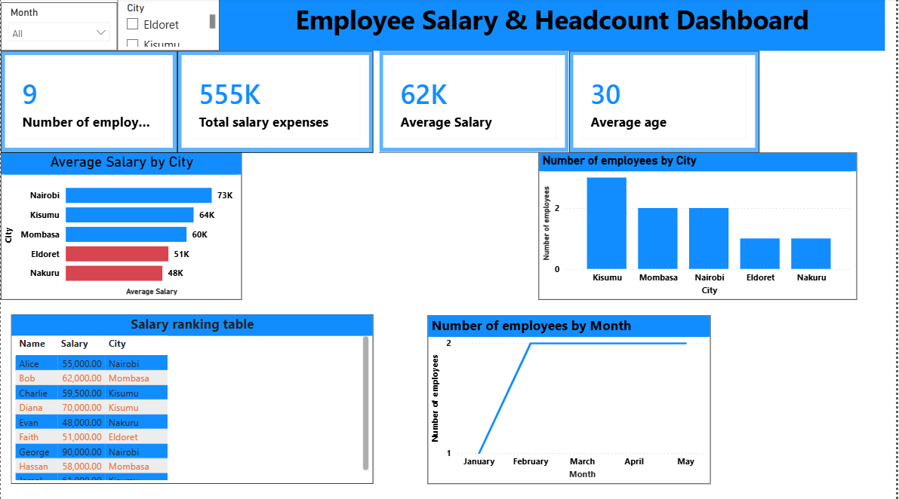
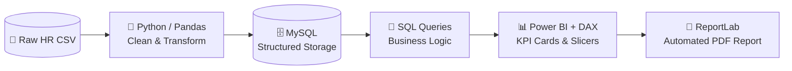

<div align="center">

# 🧑‍💼 Employee Salary & Headcount Dashboard

**An end-to-end HR analytics pipeline — from a raw, messy CSV to a decision-ready Power BI dashboard.**

`Python` · `Pandas` · `MySQL` · `SQL` · `Power BI` · `DAX` · `ReportLab`

</div>

---

## 📸 Dashboard Preview

<!-- FILL THIS IN — highest-impact item in the README.
     Export your Power BI dashboard as PNG (File → Export → Image),
     save it to an /assets folder in this repo, and it will render below. -->



> 💡 *Replace `assets/dashboard.png` with a real screenshot. Recruiters won't open a `.pbix` file — they will look at a picture.*

---

## 🎯 The Business Problem

A growing company is hiring fast across several cities, but HR has no clean view of:

- **Are we paying fairly across cities — or is location creating hidden pay gaps?**
- **How fast is headcount growing, and where?**
- **Which hires sit far outside expected pay ranges?**

The raw export is small, inconsistent, and unaggregated, so it answers none of these directly. This project builds the pipeline that turns it into answers.

---

## 🗂️ Dataset

| | |
| --- | --- |
| **Source** | Raw HR export (CSV) — deliberately messy, as in the real world |
| **Raw rows** | 10 |
| **Clean rows** | 9 |
| **Fields** | `EmployeeID`, `Name`, `Age`, `City`, `Salary`, `JoinDate` |
| **Coverage** | 5 Kenyan cities · Jan–May 2025 · ages 25–40 |

### 🧹 Data-Quality Issues & Cleaning Decisions

The raw export contained **7 distinct problems** — enough to make any naive analysis wrong. Each was fixed deliberately and documented, never silently:

| Row | Raw problem | Decision | Reasoning |
| --- | --- | --- | --- |
| `ID 2` (Bob) | `Age` blank | Imputed **29** (median age) | Median is robust to outliers; safe for a single gap |
| `ID 3` (Charlie) | `Salary` blank | Imputed **59,500** (median salary) | The 900,000 typo makes the mean unusable — median is safer |
| `ID 4` (Alice) | **Exact duplicate** of `ID 1` | **Row removed** | Same person twice would double-count headcount and salary bill |
| `ID 5` (Diana) | `City` blank | Recovered as **Kisumu** | *State your recovery method here — e.g. cross-checked the source record* |
| `ID 7` (Faith) | `Age = -5` | Corrected to **29** | A negative age is invalid data, not a real value |
| `ID 8` (George) | `Salary = 900,000` | Corrected to **90,000** | A 10× typo — inconsistent with the role and every peer |
| `ID 9` (—) | `Name` blank | Recovered as **Jamal** | *State your recovery method here* |

> ⚠️ **Why this matters.** Computed on the raw data, the average salary comes out at **KES 151,111**. The true figure is **KES 61,611** — the uncleaned number is **145% too high**. A single `900,000` typo and one duplicate row are enough to make a dashboard actively mislead. This step is the analysis.

---

## 🏗️ Architecture



**Why this order?** Each stage does one job well: Python for messy cleaning, SQL for reliable aggregation, Power BI for the visual layer, and ReportLab for a shareable report that doesn't require opening a BI tool.

---

## ❓ Questions This Analysis Answers

1. What is the total headcount and salary bill?
2. How has headcount grown month over month?
3. How does average salary differ by city?
4. How does pay relate to age / experience?
5. Which employees sit outside the normal pay range?

---

## 🔍 Key Findings

- **Headcount grew from 1 to 9 employees in five months** (Jan–May 2025), with a steady ~2 hires per month from February onward.
- **The pay distribution is right-skewed.** Mean salary is **KES 61,611** but the median is **KES 59,500** — a small number of high earners pull the average above what a typical employee earns. Any "average salary" headline is misleading on its own.
- **Nairobi pays the most — but the number is deceptive.** Its average of **KES 72,500** is **17.7% above the company mean**, yet that is driven almost entirely by a *single* senior hire. Nairobi's average is not evidence of a systematic city premium.
- **Nakuru is the lowest-paying city** at **KES 48,000**, **22% below** the company mean, and **Eldoret** sits at **KES 51,000**.
- **Pay rises steeply with age.** The youngest employee (25) earns **KES 55,000**; the oldest (40) earns **KES 90,000** — a **1.88× gap**. On this dataset, age is the strongest single predictor of salary.
- **One statistical outlier.** George's **KES 90,000** sits above the Tukey upper fence of **KES 85,500** (Q1 = 53,000, Q3 = 66,000, IQR = 13,000). He is the only employee flagged.
- **Cleaning changed the entire conclusion.** Computed on the raw export, average salary reads **KES 151,111**; correctly cleaned it is **KES 61,611** — a **145% inflation** caused by a single `900,000` typo and one duplicated row. Untreated, this data would have produced a false narrative.

> **Recommendation**
> 1. **Introduce age/experience-based pay bands** so compensation tracks seniority explicitly rather than implicitly — this removes the guesswork behind city-level differences.
> 2. **Review the single senior outlier** against market benchmarks before treating Nairobi's average as a real signal.
> 3. **Add validation at the source.** A primary-key constraint to block duplicate `EmployeeID`s, a range check to reject impossible ages, and a sanity cap on `Salary` would have caught all 7 issues before they reached a report — this is cheaper than cleaning downstream every time.

---

## 📊 Dashboard Features

- **KPI cards** — total headcount, total salary bill, average salary
- **Headcount trend line** — monthly hiring, Jan–May 2025
- **City slicer** — filter every visual by location
- **Average salary by city** — ranked comparison
- **Age vs salary scatter** — visualises the experience–pay relationship and isolates the outlier
- **Automated PDF export** — a shareable report generated with ReportLab

---

## 📁 Repository Structure

```
employee-salary-headcount-dashboard/
├── assets/
│   └── dashboard.png          # dashboard screenshot
├── data/
│   └── raw_employees.csv      # source data
├── notebooks/
│   └── cleaning.ipynb         # Python/Pandas cleaning
├── sql/
│   └── analysis_queries.sql   # business-logic queries
├── reports/
│   └── employee_report.pdf    # ReportLab output
├── dashboard.pbix             # Power BI file
└── README.md
```

> Adjust the file names above to match your actual repo.

---

## ▶️ How to Reproduce

```bash
# 1. Clone
git clone https://github.com/Riq-wq/employee-salary-headcount-dashboard.git
cd employee-salary-headcount-dashboard

# 2. Install Python dependencies
pip install pandas mysql-connector-python reportlab

# 3. Run the cleaning script
python notebooks/cleaning.py

# 4. Load into MySQL
mysql -u <user> -p < schema.sql

# 5. Open dashboard.pbix in Power BI Desktop and refresh
```

---

## 🧠 Skills Demonstrated

| Skill | Where |
| --- | --- |
| **Data cleaning** — missing values, duplicate detection, invalid ranges, outlier correction | `notebooks/cleaning.ipynb` |
| **Relational storage & schema design** | MySQL |
| **Business-logic SQL** — aggregation, grouping, ranking | `sql/analysis_queries.sql` |
| **Distribution analysis** — mean vs median, IQR outlier detection | Analysis + report |
| **Data modeling & DAX measures** | Power BI |
| **Automated reporting** | ReportLab |
| **End-to-end pipeline thinking** | Whole repo |

---

## 🚀 What I'd Do Next

- Add **department / job-title data** to separate *pay-for-role* from *pay-for-location* — the current data can't distinguish them.
- Add **salary-benchmark comparison** against external market data.
- Scale the pipeline to a **scheduled cloud refresh** (dbt + a warehouse) as headcount grows.

---

<div align="center">
<sub>Built by <a href="https://github.com/Riq-wq">Hassan Jumaa</a> · <a href="https://riq-wq.github.io/Myportfolio/">Portfolio</a> · <a href="https://www.linkedin.com/in/mrisa-juma-56a600416">LinkedIn</a></sub>
</div>
