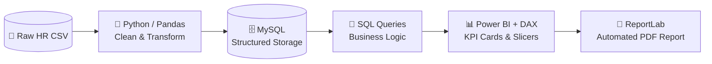

<div align="center">

# Employee Salary & Headcount Dashboard

**An end-to-end HR analytics pipeline — from a raw, messy CSV to a decision-ready Power BI dashboard.**

`Python` · `Pandas` · `MySQL` · `SQL` · `Power BI` · `DAX` · `ReportLab`

</div>

---

## Dashboard Preview


---

## 🎯 The Business Problem

A growing company is hiring fast across several cities, but HR has no clean view of:

- **Are we paying fairly across cities — or is location creating hidden pay gaps?**
- **How fast is headcount growing, and where?**
- **Which hires sit far outside expected pay ranges?**

The raw export is small, inconsistent, and unaggregated, so it answers none of these directly. This project builds the pipeline that turns it into answers.

---

## 🗂️ Dataset

| | |
| --- | --- |
| **Source** | Raw HR export (CSV) — deliberately messy, as in the real world |
| **Raw rows** | 10 |
| **Clean rows** | 9 |
| **Fields** | `EmployeeID`, `Name`, `Age`, `City`, `Salary`, `JoinDate` |
| **Coverage** | 5 Kenyan cities · Jan–May 2025 · ages 25–40 |

### 🧹 Data-Quality Issues & Cleaning Decisions

The raw export contained **7 distinct problems** — enough to make any naive analysis wrong. Each was fixed deliberately and documented, never silently:

| Row | Raw problem | Decision | Reasoning |
| --- | --- | --- | --- |
| `ID 2` (Bob) | `Age` blank | Imputed **29** (median age) | Median is robust to outliers; safe for a single gap |
| `ID 3` (Charlie) | `Salary` blank | Imputed **59,500** (median salary) | The 900,000 typo makes the mean unusable — median is safer |
| `ID 4` (Alice) | **Exact duplicate** of `ID 1` | **Row removed** | Same person twice would double-count headcount and salary bill |
| `ID 5` (Diana) | `City` blank | Filled with **Kisumu** | ⚠️ **Assumption, not a recovery** — see [Limitations](#-limitations--honest-scope) |
| `ID 7` (Faith) | `Age = -5` | Corrected to **29** | A negative age is invalid data, not a real value |
| `ID 8` (George) | `Salary = 900,000` | Corrected to **90,000** | A 10× typo — inconsistent with the role and every peer |
| `ID 9` (—) | `Name` blank | Placeholder **"Jamal"** | ⚠️ Name assumed — see [Limitations](#-limitations--honest-scope) |

> 📎 **Row IDs refer to the raw export.** The cleaned file drops the duplicate and renumbers, so raw `ID 5` (Diana) is `ID 4` in `employee_dataset_cleaned.csv` — cross-reference by name, not by number.

> ⚠️ **Why this matters.** Computed on the raw data, the average salary comes out at **KES 151,111**. The true figure is **KES 61,611** — the uncleaned number is **145% too high**. A single `900,000` typo and one duplicate row are enough to make a dashboard actively mislead. This step is the analysis.

---

## ⚠️ Limitations & Honest Scope

A dashboard that hides its own gaps is worse than no dashboard. Two values in this dataset are **assumptions I made, not facts I recovered** — stated plainly so the numbers can be trusted correctly:

| Value | Status | Why it is not recoverable | Impact |
| --- | --- | --- | --- |
| **Diana's `City` → Kisumu** | **Assumption** | Location cannot be derived from age, salary, or join date. The mode is not unique — Kisumu, Mombasa and Nairobi each appear twice, so "most common city" has no single answer. | Affects **one cell**: Kisumu's average is **63,500** *with* the assumption, **60,250** without it. |
| **ID 9's `Name` → "Jamal"** | **Placeholder** | Names carry no analytical weight — no calculation touches this field. | **None.** No metric depends on it. |

**What survives either way.** Total salary **554,500** · mean **61,611** · median **59,500** · the **145%** cleaning finding · the **outlier detection** — all identical regardless of either assumption. Only Kisumu's city average moves.

**If I were redoing this for a real stakeholder:** I would leave both fields as `Unknown`, exclude Diana from the city comparison, and report **8 of 9** employees against location. On a nine-row dataset that costs almost nothing, and it removes the only judgment call in the pipeline.

---

## 🏗️ Architecture



**Why this order?** Each stage does one job well: Python for messy cleaning, SQL for reliable aggregation, Power BI for the visual layer, and ReportLab for a shareable report that doesn't require opening a BI tool.

---

## ❓ Questions This Analysis Answers

1. What is the total headcount and salary bill?
2. How has headcount grown month over month?
3. How does average salary differ by city?
4. How does pay relate to age / experience?
5. Which employees sit outside the normal pay range?

---

## 🔍 Key Findings

- **Headcount grew from 1 to 9 employees in five months** (Jan–May 2025), with a steady ~2 hires per month from February onward.
- **The pay distribution is right-skewed.** Mean salary is **KES 61,611** but the median is **KES 59,500** — a small number of high earners pull the average above what a typical employee earns. Any "average salary" headline is misleading on its own.
- **Nairobi pays the most — but the number is deceptive.** Its average of **KES 72,500** is **17.7% above the company mean**, yet that is driven almost entirely by a *single* senior hire. Nairobi's average is not evidence of a systematic city premium.
- **Nakuru is the lowest-paying city** at **KES 48,000**, **22% below** the company mean, and **Eldoret** sits at **KES 51,000**.
- **Age is the strongest single predictor of salary.** Pearson **r = 0.845** (**r² = 0.71**) — age alone explains roughly **71%** of salary variance in this dataset. The youngest employee (25) earns **KES 55,000**; the oldest (40) earns **KES 90,000** — a **1.64×** gap.
- **One statistical outlier.** George's **KES 90,000** sits above the Tukey upper fence of **KES 85,500** (Q1 = 53,000, Q3 = 66,000, IQR = 13,000). He is the only employee flagged.
- **Cleaning changed the entire conclusion.** Computed on the raw export, average salary reads **KES 151,111**; correctly cleaned it is **KES 61,611** — a **145% inflation** caused by a single `900,000` typo and one duplicated row. Untreated, this data would have produced a false narrative.

> **Recommendation**
> 1. **Introduce age/experience-based pay bands** so compensation tracks seniority explicitly rather than implicitly — the r² of 0.71 says seniority is already driving pay, just informally.
> 2. **Review the single senior outlier** against market benchmarks before treating Nairobi's average as a real signal.
> 3. **Add validation at the source.** A primary-key constraint to block duplicate `EmployeeID`s, a range check to reject impossible ages, and a sanity cap on `Salary` would have caught all 7 issues before they reached a report — this is cheaper than cleaning downstream every time.

---

## 📊 Dashboard Features

- **KPI cards** — total headcount, total salary bill, average salary
- **Headcount trend line** — monthly hiring, Jan–May 2025
- **City slicer** — filter every visual by location
- **Month slicer** -filter every visual by month
- **Average salary by city** — ranked comparison
- **Age vs salary scatter** — visualises the experience–pay relationship and isolates the outlier
- **Automated PDF export** — a shareable report generated with ReportLab

### Individual visuals

| | | |
| :---: | :---: | :---: |
|  |  |  |
| **Headcount by city** | **Hiring trend** | **Salary by city** |

---

## 📁 Repository Structure

```
employee-salary-headcount-dashboard/
├── assets/
│   └── dashboard.png                              # Power BI dashboard screenshot
├── data/
│   ├── employee dataset.csv                       # raw HR export (10 rows, messy)
│   └── employee_dataset_cleaned.csv               # cleaned output (9 rows)
├── dashboard/
│   └── Employee salary dashboard.pbix             # Power BI file
├── notebooks/
│   └── employee  data cleaning.ipynb              # Python/Pandas cleaning + MySQL load
├── reports/
│   ├── Employee Salary & Headcount Dashboard.pptx # slide deck
│   ├── Employee_Salary_Dashboard_Report.pdf       # ReportLab PDF output
│   ├── charts/
│   │   ├── headcount_by_city.png
│   │   ├── hiring_trend.png
│   │   └── salary_by_city.png
│   └── generate_report.py                         # regenerates the PDF from the data
├── sql/
│   └── employees queries.sql                      # business-logic queries
├── .gitignore
└── README.md
```

---

## ▶️ How to Reproduce

```bash
# 1. Clone
git clone https://github.com/Riq-wq/employee-salary-headcount-dashboard.git
cd employee-salary-headcount-dashboard

# 2. Install Python dependencies
pip install pandas sqlalchemy pymysql reportlab jupyter

# 3. Create the database
mysql -u <user> -p -e "CREATE DATABASE employee_db;"

# 4. Run the cleaning notebook (cleans data + loads it into MySQL)
jupyter notebook "notebooks/employee  data cleaning.ipynb"
#    -> run all cells; connects via .env, loads to employee_db

# 5. Run the analysis queries
mysql -u <user> -p employee_db < "sql/employees queries.sql"

# 6. Open "dashboard/Employee salary dashboard.pbix" in Power BI Desktop and refresh

# 7. Regenerate the PDF report from the data (optional)
python reports/generate_report.py
```

> **Note:** the notebook reads DB credentials from an untracked `.env` file. Create one next to the notebook with your own values — never hard-code them:
> ```
> DB_USER=<user>
> DB_PASSWORD=<your-password>
> DB_HOST=localhost
> DB_NAME=employee_db
> ```

---

## 🧠 Skills Demonstrated

| Skill | Where |
| --- | --- |
| **Data cleaning** — missing values, duplicate detection, invalid ranges, outlier correction | `notebooks/employee  data cleaning.ipynb` |
| **Relational storage & schema design** | MySQL |
| **Business-logic SQL** — aggregation, grouping, ranking | `sql/employees queries.sql` |
| **Distribution analysis** — mean vs median, IQR outlier detection | Analysis + report |
| **Statistical testing** — Pearson correlation, r² | Age vs salary finding |
| **Data modeling & DAX measures** | Power BI |
| **Automated reporting** | ReportLab |
| **End-to-end pipeline thinking** | Whole repo |

---

## 🚀 What I'd Do Next

- Add **department / job-title data** to separate *pay-for-role* from *pay-for-location* — the current data can't distinguish them, which is why Nairobi's premium is ambiguous.
- Replace the two assumed values with **real source records**, then re-run the city comparison at 9 of 9.
- Add **salary-benchmark comparison** against external market data.
- Scale the pipeline to a **scheduled cloud refresh** (dbt + a warehouse) as headcount grows.

---

<div align="center">
<sub>Built by <a href="https://github.com/Riq-wq">Hassan Jumaa</a> · <a href="https://riq-wq.github.io/Myportfolio/">Portfolio</a> · <a href="https://www.linkedin.com/in/mrisa-juma-56a600416">LinkedIn</a></sub>
</div>
